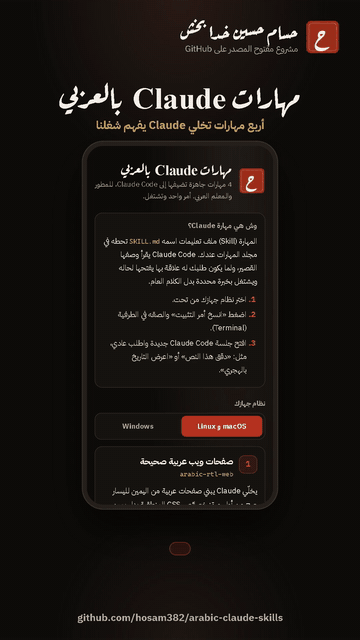

# مهارات Claude بالعربي | Arabic Claude Skills
**By [Hassam](https://github.com/hosam382)**

الصفحة: [hosam382.github.io/arabic-claude-skills](https://hosam382.github.io/arabic-claude-skills/)



[شاهد فيديو الشرح كامل مع الموسيقى (MP4)](demo.mp4)

## وش هي المهارات؟

المهارة (Skill) في Claude Code ملف تعليمات اسمه `SKILL.md`، في أوله وصف قصير يقول وش تسوي المهارة ومتى تُستخدم.
تحطه في مجلد المهارات عندك، وClaude يقرأ الوصف، ولما يكون طلبك له علاقة بها يفتح التعليمات كاملة ويشتغل بخبرة محددة بدل الكلام العام.

هذا المستودع فيه 4 مهارات كتبتها للمطور والمعلم العربي. كل مهارة ملف نص واحد، تقدر تقراه كامل قبل ما تثبته.

## المهارات الأربع

| المهارة | وش تسوي |
|---|---|
| [`arabic-rtl-web`](arabic-rtl-web/SKILL.md) | تبني صفحات ويب عربية من اليمين لليسار صح: خصائص CSS المنطقية، خطوط عربية محفوظة داخل الموقع، عزل الأرقام والروابط وسط النص العربي، نظام أرقام واحد في الصفحة، وقراءة الأرقام العربية اللي يكتبها المستخدم. |
| [`arabic-writing-review`](arabic-writing-review/SKILL.md) | تدقق النص الفصيح وترجع جدول (الخطأ، الصواب، السبب): الهمزات، التاء المربوطة، الألف المقصورة، تنوين النصب، الترقيم، واللهجة في النص الرسمي. وإذا ما كانت متأكدة تعلّم على الكلمة بدل ما تغيّرها. |
| [`saudi-school-reports`](saudi-school-reports/SKILL.md) | تكتب تقارير البرامج والأنشطة المدرسية بالأقسام المعروفة، بالتاريخين الهجري والميلادي، بدون اختراع أرقام، مع احترام خصوصية الطلاب، وبنسختين: صفحة واحدة ومفصلة. |
| [`hijri-dates`](hijri-dates/SKILL.md) | تتعامل مع تقويم أم القرى في JavaScript و Python: العرض، والتحويل في الاتجاهين، والتحقق، وأشهر الأخطاء. |

## طريقة التثبيت

غيّر `<name>` باسم المهارة اللي تبيها (مثلًا `hijri-dates`)، أو انسخ الأمر جاهز من [الصفحة](https://hosam382.github.io/arabic-claude-skills/).

**macOS و Linux:**

```bash
mkdir -p ~/.claude/skills/<name> && curl -fsSL https://raw.githubusercontent.com/hosam382/arabic-claude-skills/main/<name>/SKILL.md -o ~/.claude/skills/<name>/SKILL.md
```

**Windows (PowerShell):**

```powershell
New-Item -ItemType Directory -Force "$HOME\.claude\skills\<name>" | Out-Null; Invoke-WebRequest https://raw.githubusercontent.com/hosam382/arabic-claude-skills/main/<name>/SKILL.md -OutFile "$HOME\.claude\skills\<name>\SKILL.md"
```

الأمر ينزّل ملف `SKILL.md` بس ويحطه في `~/.claude/skills/<name>/`، وما يشغّل أي برنامج.
تبيها لمشروع واحد بس؟ حطها في `.claude/skills/<name>/` داخل مجلد المشروع بدل مجلد المستخدم.

## كيف تستخدمها

افتح جلسة Claude Code جديدة واطلب طلبك عادي، وClaude يختار المهارة المناسبة لحاله. أمثلة:

- «سوّ لي صفحة هبوط عربية لمتجري» تستدعي `arabic-rtl-web`.
- «دقق هذا النص قبل ما أنشره» تستدعي `arabic-writing-review`.
- «اكتب تقرير عن برنامج اليوم العالمي للغة العربية» تستدعي `saudi-school-reports`.
- «اعرض تاريخ اليوم بالهجري في موقعي» تستدعي `hijri-dates`.

تقدر تطلبها بالاسم بعد، مثل: `/hijri-dates`.

## للمطورين

```bash
node build.js   # يولّد skills-data.js من ملفات SKILL.md
npm test        # يتأكد من رأس كل مهارة وإن skills-data.js محدث
```

الصفحة ملفات ثابتة (`index.html`، `style.css`، `app.js`) بدون أي طلبات خارجية: الخطوط محفوظة داخل المستودع.

## English

Four Claude Code Agent Skills for Arabic and Saudi developers and educators. A skill is a folder with a `SKILL.md` file whose short description tells Claude when to load the full instructions.

- **arabic-rtl-web**: correct Arabic RTL pages (logical CSS properties, self-hosted Arabic fonts, bidi isolation for numbers and URLs, one digit system per page, parsing Arabic-Indic digits from inputs, mirroring rules).
- **arabic-writing-review**: careful proofreading of Modern Standard Arabic with a mistake / correction / reason table; uncertain cases are flagged, not changed.
- **saudi-school-reports**: formal school activity and program reports with the standard sections, Hijri and Gregorian dates, no invented numbers, student privacy, one-page and detailed versions.
- **hijri-dates**: Umm al-Qura dates in JavaScript (`Intl`) and Python (`hijridate`), conversion both ways, validation and common pitfalls.

Install one with the command above (replace `<name>`), then start a new Claude Code session. Each skill is a single `SKILL.md` file; read it before installing.

بُني بمساعدة الذكاء الاصطناعي (Claude) وراجعه حسام.
Built with AI assistance (Claude), reviewed by Hassam.

## License

MIT. See [LICENSE](LICENSE).
